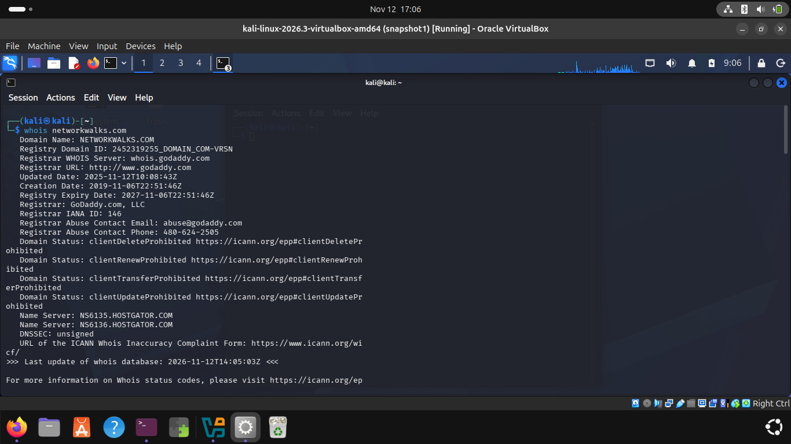
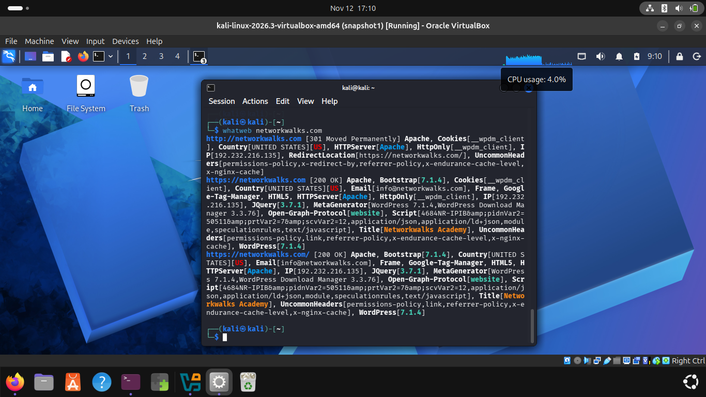
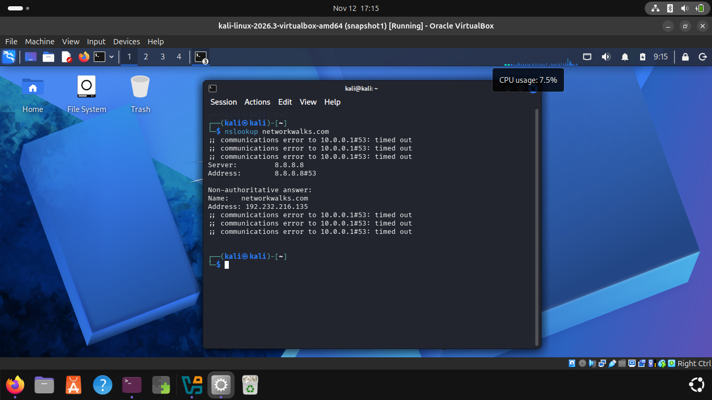
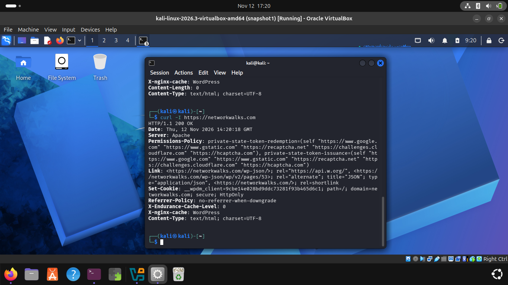
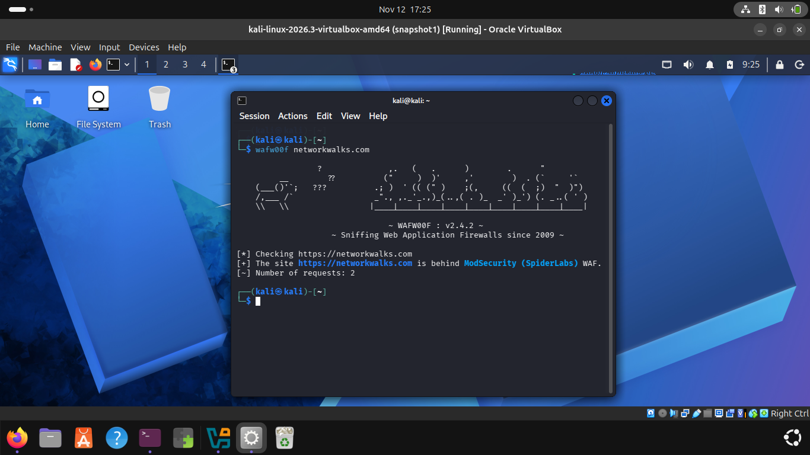
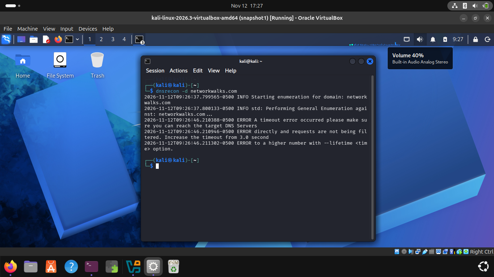
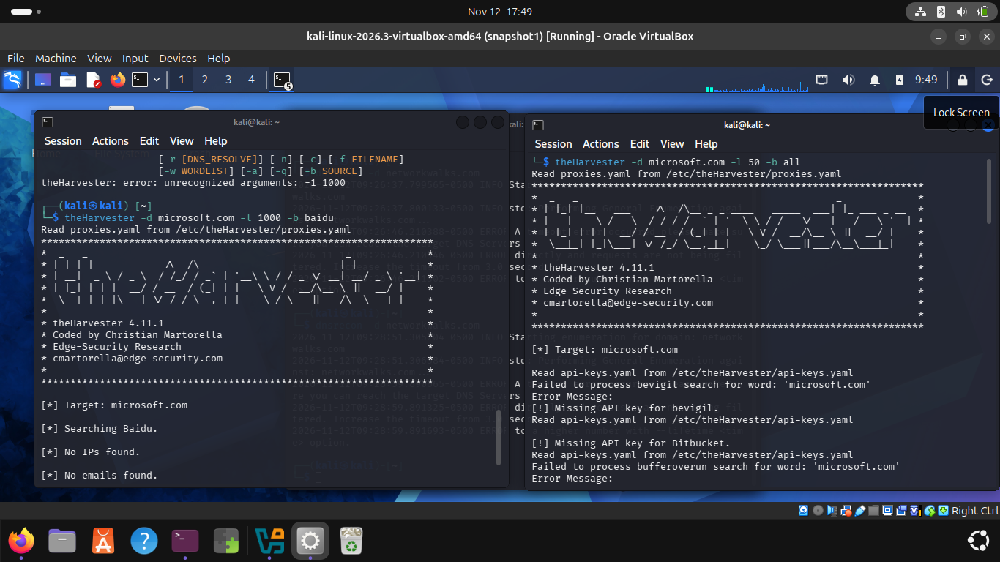
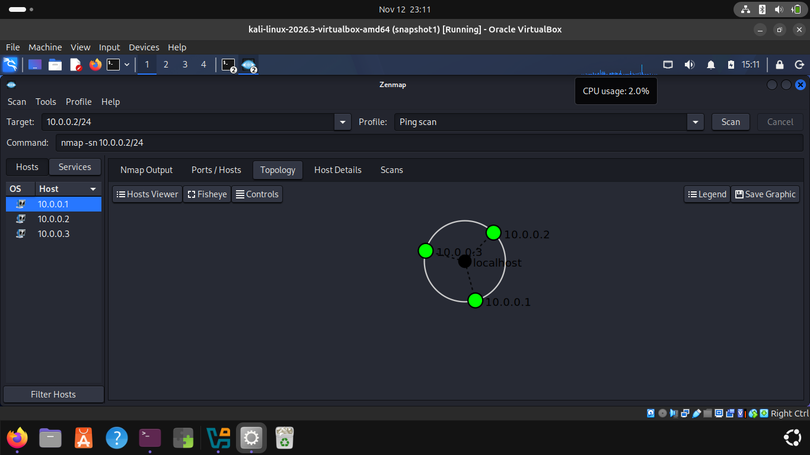

# Networkwalks Cybersecurity – Week 2

## Footprinting and Network Scanning

## 1. Project Overview

This project documents the practical cybersecurity activities completed during Week 2 of my Networkwalks internship.

The exercises focused on footprinting, reconnaissance, Open-Source Intelligence (OSINT), and network scanning using Kali Linux tools and Zenmap.

## 2. Activities Completed

### Activity 1: Footprinting using Kali Linux

The following tools were used to gather information about the authorized target:

- WHOIS
- WhatWeb
- Nslookup
- Curl
- Wafw00f
- DNSRecon

### Activity 2: theHarvester Footprinting

Used theHarvester to collect publicly available information, including email addresses, subdomains and hosts, where available.

### Activity 3: Network Scanning using Zenmap

Used Zenmap to perform network discovery on my local network, identify active hosts and examine network scan results and topology.

## 3. Tools and Technologies

- Kali Linux
- WHOIS
- WhatWeb
- Nslookup
- Curl
- Wafw00f
- DNSRecon
- theHarvester
- Zenmap / Nmap

## 4. Project Report

The full practical report, including methodology, findings, risk analysis, recommendations and evidence, is available here:

[View the Week 2 Penetration Testing Report](reports/penetration-testing-report.md)

## 5. Evidence

### Footprinting Using Kali Linux Tools

**1. WHOIS**

**2. WhatWeb**

**3. Nslookup**

**4. cURL**

**5. Wafw00f**

**6. DNSRecon**

### theHarvester Footprinting

### Zenmap Network Scanning

## 6. Learning Outcomes

Through these exercises, I gained practical experience in:

- Gathering publicly available domain information.
- Identifying website technologies.
- Performing DNS enumeration.
- Inspecting HTTP response headers.
- Identifying Web Application Firewalls.
- Collecting OSINT using theHarvester.
- Discovering active hosts using Zenmap.
- Documenting findings and evaluating potential security risks.

## 7. Ethical Considerations

All testing must be conducted on systems and networks that I own or have explicit authorization to assess. The activities documented here are intended for educational purposes and ethical cybersecurity practice.

---
